# Daemonling

**A tiny daemon that lives on your focus.**

[](https://github.com/mourya-dasgupta/daemonling/actions/workflows/ci.yml)


```
    *     *
     \   /
   .-'"""'-.
  (  ^   ^  )
  (   \_/   )
   '-.___.-'~~>
```

Daemonling is a virtual pet for solo developers that lives in your terminal, VS Code and browser.
Focus sessions feed it, daily streaks teach it tricks, and weeks of work evolve it into a species
shaped by how you work — while overwork and late nights tire it, and neglect sends it into a cozy
cocoon (it never dies). It is open source, local-first, and never sends your data anywhere.



## Features

- **Focus sessions that feed your pet** — `dmn start` shows a live countdown with an animated ASCII
  daemon; finishing feeds it, cheers it up and earns XP.
- **Honesty pays** — stop early and say you got distracted: you keep more XP than if you quietly
  quit.
- **Streaks, earned freezes and tricks** — meet your daily goal to build a streak; every 7 days
  earns a freeze; streaks teach tricks from `wave` to `signature-move`.
- **Evolution shaped by your work** — deep sessions, sprints, breaks, commits or late nights decide
  whether it grows into an owlbyte, sprintail, zenpaca, shipwyrm or nocturne.
- **Burnout guardian** — three hours without a break makes it yawn; late sessions tire it. Breaks
  restore it.
- **Never dies** — a week away and it hibernates in a cocoon; two sessions wake it up, no penalty.
- **Vacation mode** — pause everything, streak safe.
- **VS Code companion** — status-bar pet with session timer, a den webview, and privacy-first focus
  sensing (window focus only).
- **Web home** — an offline PWA with Den, Focus, Stats, Journal and Settings.
- **Developer-native extras** — git commit treats, CI celebrations, rubber-duck debugging
  (`dmn duck`), a weekly journal in your pet's voice, an SVG README card, and a shell-prompt line.



## Quick start

Requires Node.js 20+ (22 recommended) and pnpm (`corepack enable`).

```bash
git clone https://github.com/mourya-dasgupta/daemonling && cd daemonling
pnpm install && pnpm build
```

### CLI

```bash
ln -s "$PWD/apps/cli/dist/dmn.js" ~/.local/bin/dmn   # or any directory on your PATH
dmn init --name Pixel
dmn start            # 25-minute session; Ctrl+C asks if you got distracted
dmn status
```

More: `dmn --help`, and the [user guide](docs/GUIDE.md). (npm publication is on the
[roadmap](docs/ROADMAP.md); then it is `npm i -g daemonling`.)

### VS Code

```bash
pnpm --filter daemonling-vscode package
code --install-extension apps/vscode/daemonling-0.1.0.vsix
```

CI also builds the `.vsix` as a downloadable artifact on every run. The extension shares
`~/.daemonling` with the CLI.

### Web

```bash
pnpm --filter web build && pnpm --filter web preview
```

Or deploy it to GitHub Pages with the included workflow (see the [runbook](docs/RUNBOOK.md)). The
web app keeps its own pet in your browser; move pets with `dmn export` / "Import JSON".

## Monorepo map

| Path               | What it is                                                                     |
| ------------------ | ------------------------------------------------------------------------------ |
| `packages/core`    | Pure, deterministic pet simulation (event-sourced reducer, all rules)          |
| `packages/store`   | Event log + snapshot persistence: Node files and browser IndexedDB; migrations |
| `packages/sprites` | Original art: ASCII frames, SVG pet renderer, README card                      |
| `apps/cli`         | The `dmn` command                                                              |
| `apps/vscode`      | VS Code extension                                                              |
| `apps/web`         | React + Vite offline PWA                                                       |
| `docs/`            | Guide, game design, architecture, runbook, roadmap, pitch and more             |

```bash
pnpm lint && pnpm typecheck && pnpm test && pnpm build   # what CI runs
```

## Privacy promise

No accounts, no servers, no telemetry, no ads, no network calls at runtime. Daemonling never reads
your code, file names or keystrokes; the VS Code extension only notices whether its window has
focus during a session. Your pet is a plain-text event log you can read, export or delete. Full
details: [PRIVACY.md](PRIVACY.md).

## Roadmap

Private beta (Nov–Dec 2026) → public launch (Jan 2027) → optional sync and Pro (Feb–Apr 2027) →
mobile and teams (May–Jul 2027). Next up: co-focus dens, the "Scope Creep" ship-day boss fight, and
heirloom eggs. See [docs/ROADMAP.md](docs/ROADMAP.md).

## Documentation

[User guide](docs/GUIDE.md) · [Game design](docs/GAME_DESIGN.md) ·
[Architecture](docs/ARCHITECTURE.md) · [Runbook](docs/RUNBOOK.md) · [Product spec](docs/PRODUCT_SPEC.md) ·
[README card](docs/README-CARD.md) · [Decisions](docs/DECISIONS.md) · [Build log](docs/BUILD_LOG.md)

## Contributing

Contributions are welcome — see [CONTRIBUTING.md](CONTRIBUTING.md) and the
[security policy](SECURITY.md). Please keep the engine pure and the privacy promise intact.

## License

[MIT](LICENSE). All pet art in this repository is original.
