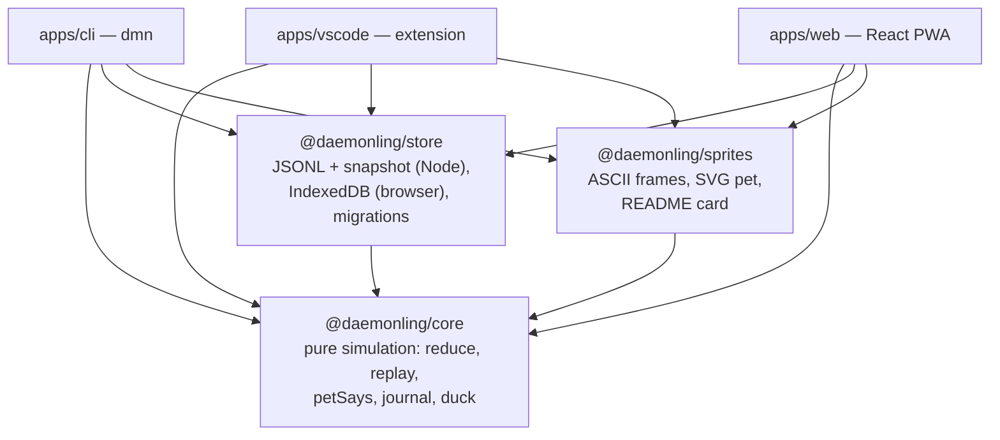
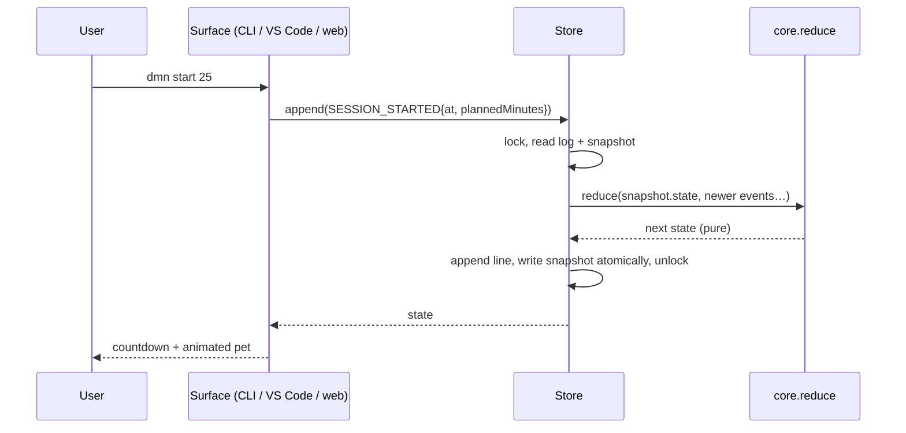
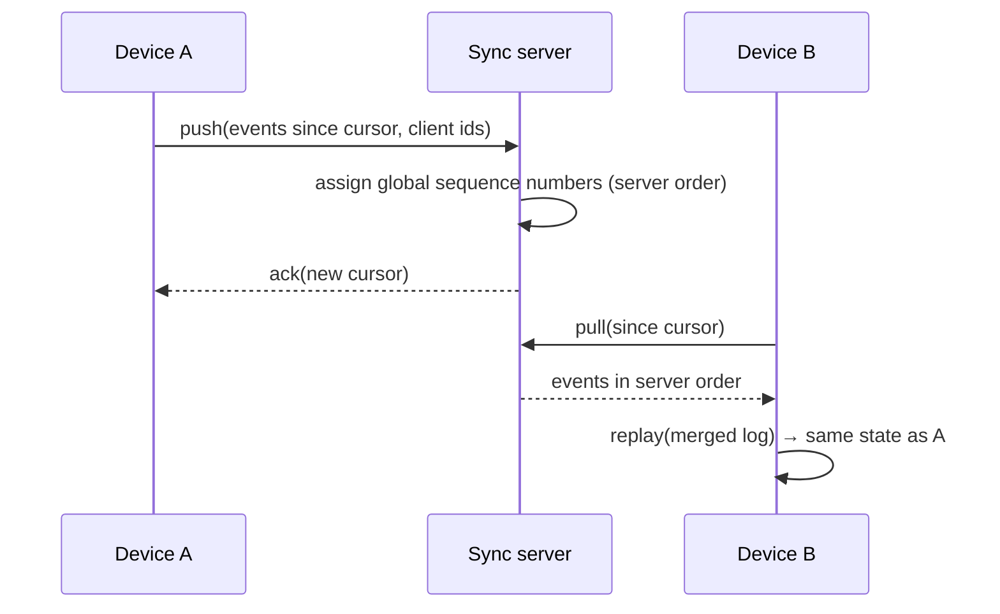

# Architecture

Daemonling is a local-first, event-sourced application with one pure engine and three thin
surfaces.

## Packages

| Package            | Runtime        | Responsibility                                                                                  | Build                                            |
| ------------------ | -------------- | ----------------------------------------------------------------------------------------------- | ------------------------------------------------ |
| `packages/core`    | any JS         | State, events, every rule, conditions, voice, journal, week stats, rubber-duck picker           | `tsc` → ESM                                      |
| `packages/store`   | Node + browser | Record format v2, v1→v2 migration, snapshot reuse, export/import, `FileStore`, `IndexedDbStore` | `tsc` → ESM (`.` and `./node`)                   |
| `packages/sprites` | any JS         | Moods, ASCII frames, SVG renderer with CSS-variable palette, README card                        | `tsc` → ESM                                      |
| `apps/cli`         | Node ≥ 20      | `dmn` commands, countdown, hook installer                                                       | esbuild → `dist/dmn.js` + chunks                 |
| `apps/vscode`      | VS Code ≥ 1.95 | Status bar, quick pick, focus sensing, den webview                                              | esbuild → `dist/extension.cjs`, `vsce` → `.vsix` |
| `apps/web`         | browsers       | Den, Focus, Stats, Journal, Settings; service worker                                            | Vite → static `dist/`                            |

Workspace packages are resolved from TypeScript sources during development and bundling through a
custom `daemonling-source` export condition (D-002); published builds use `dist`.

## Event sourcing

- **The log is the truth.** `state = replay(events)`; the snapshot is only a cache.
- **The reducer is pure.** No clock, no randomness, no I/O. Time comes from `event.at`. Message
  variety uses a deterministic hash of a seed (the date).
- **Passive time is computed, not stored.** Each event first applies the time elapsed since the
  previous event (decay over awake hours in the user's time zone, hunger, hibernation, day rollover,
  streak settlement), then its own rule. UIs apply a `TICK` in memory to show "now" without writing.
- **Rule changes apply retroactively.** Because state is a replay, tuning a constant changes every
  pet consistently on next load (the snapshot is discarded when `CONFIG.stateSchemaVersion` changes).

## Store format

`~/.daemonling/` (override with `DAEMONLING_HOME`):

| File                    | Format                                                                               |
| ----------------------- | ------------------------------------------------------------------------------------ |
| `events.jsonl`          | One JSON object per line: `{"v":2,"type":"SESSION_COMPLETED","at":"…","minutes":25}` |
| `snapshot.json`         | `{ snapshotVersion, stateSchemaVersion, eventCount, state }`                         |
| `events.lock`           | Exists only while a writer holds the lock (`pid timestamp`)                          |
| `events.jsonl.bak-<ms>` | Previous log, kept by `dmn import`                                                   |

**Versioning.** Every record carries `v`. Readers migrate old records on the fly
(`migrateRecord`): v1 (pre-release: `kind`/`ts`/`mins`, `SESSION_DONE`) → v2. Unknown future
versions and malformed lines are skipped and counted, never fatal.

**Snapshot reuse.** A snapshot is used only if its versions match, its `eventCount` is not ahead of
the log, and its pet id matches the first event; then only the newer events are reduced.

**Browser.** `IndexedDbStore` keeps the same records in an auto-increment `events` object store and
the snapshot in `meta`, updated in a single read-write transaction. Tabs notify each other through a
`BroadcastChannel`.

## Concurrency between the CLI and VS Code

| Concern                     | Mechanism                                                                                                      |
| --------------------------- | -------------------------------------------------------------------------------------------------------------- |
| Two writers at once         | Exclusive lock file (`open(path, 'wx')`), 15 ms retry, 5 s timeout with a friendly message                     |
| A writer crashed holding it | Locks older than 10 s are treated as abandoned and removed                                                     |
| Torn writes                 | Appends are one `write` of whole lines; snapshot is written to a temp file and renamed                         |
| Stale readers               | Readers replay events beyond the snapshot's `eventCount`; VS Code reloads when the log's size or mtime changes |
| Both finish a session       | The reducer ignores `SESSION_COMPLETED` without an active session (D-011)                                      |
| Clock skew between writers  | Events older than the previous event are applied at the previous event's time (D-014)                          |

## Future sync design (not built)

Sync is a Pro roadmap item. The design keeps the engine untouched:

- **Server-ordered event log, no CRDTs.** Each device appends locally with a client event id; the
  server assigns a total order. Every device replays the same ordered log, so states converge.
- **Idempotent and conflict-light.** Duplicate session completions are already no-ops; out-of-order
  timestamps are already clamped.
- **Privacy.** Opt-in only; end-to-end encryption of event payloads is a design goal so the server
  stores ciphertext plus ordering metadata. `PRIVACY.md` must be updated before any of this ships.

## Threat model summary

| Asset / threat                               | Mitigation                                                                                             |
| -------------------------------------------- | ------------------------------------------------------------------------------------------------------ |
| Leaking what a developer works on            | Never read code, files or window titles; focus sensing uses one boolean; no network calls at runtime   |
| Data loss from crashes or concurrent writers | Append-only log, lock file, atomic snapshot, import backups, snapshot rebuild from the log             |
| Malicious import file                        | Schema validation per event type; invalid files rejected with a friendly error; old log backed up      |
| XSS in the web app or VS Code webview        | Pet name escaped in all SVG/HTML; webview CSP `default-src 'none'` with a script nonce                 |
| Git hook abuse                               | Hook block is static text; runs only `dmn event commit --sha …`; never fails a commit                  |
| Supply chain                                 | Small dependency set (commander, react, react-dom at runtime); lockfile with `--frozen-lockfile` in CI |
| Local tampering (editing the log to cheat)   | Accepted: it is your pet. Minutes are clamped to 240 per session to avoid accidents                    |
| Dark patterns                                | No paid revival, earned (not bought) freezes, max two unsolicited notifications per day                |
