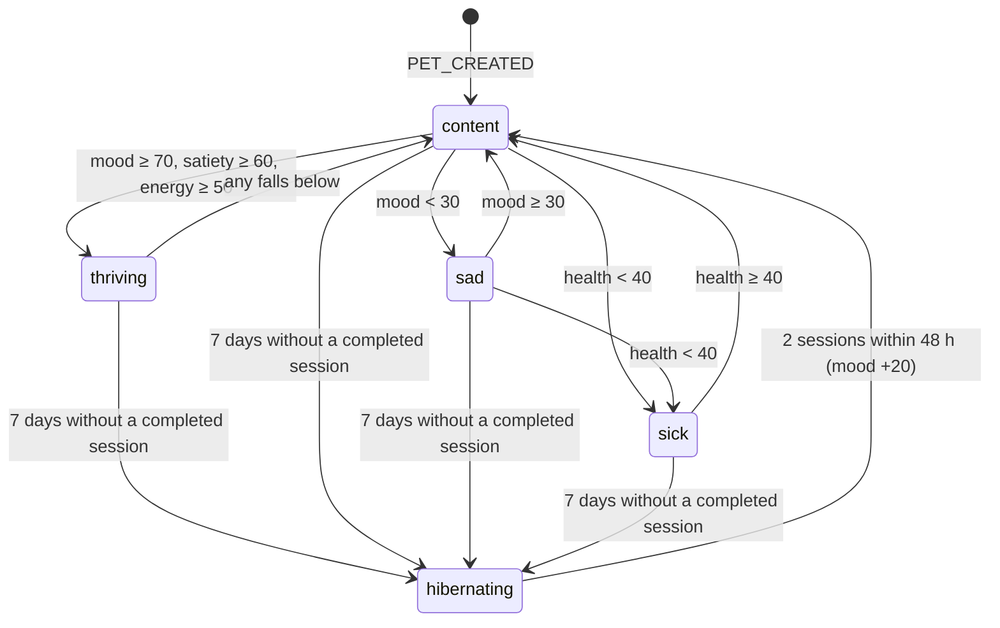

# Game design

Every rule in this document is implemented in `packages/core` and every number lives in
`packages/core/src/config.ts`. If this document and `config.ts` disagree, the code wins — please fix
the doc.

## Design pillars

1. **Responsibility beats reward.** You keep a small creature well by working well. It is not a
   points machine.
2. **Balance over maximum minutes.** Overwork and late nights tire the pet; breaks are rewarded.
3. **Honesty always pays.** Admitting you got distracted earns more than quitting silently.
4. **No death, no guilt.** Neglect leads to a cocoon, not a grave. Coming back is celebrated, never
   punished. Nothing is ever sold to "revive" a pet.
5. **Deterministic and local.** Same events → same pet, on any device, forever.

## State

| Field                    | Type / range                                                    | Notes                                                     |
| ------------------------ | --------------------------------------------------------------- | --------------------------------------------------------- |
| `stage`                  | egg → hatchling → juvenile → adult → elder                      | Never goes backwards                                      |
| `species`                | `unhatched`, `sprout`, then one of five evolved species         | Fixed once adult                                          |
| `condition`              | thriving, content, sad, sick, hibernating                       | Derived after every event                                 |
| `stats`                  | satiety, mood, health, energy, bond — each 0..100               | Health never below 10                                     |
| `xp`                     | ≥ 0                                                             | Mostly focused minutes                                    |
| `traits`                 | depth, sprint, balance, craft, night — running counts           | Decide the species                                        |
| `streak`                 | current, best, freezes (0..2), lastCountedDay                   | Calendar days in the user's time zone                     |
| `tricks`                 | list of names                                                   | Never removed                                             |
| `settings`               | dailyGoalMinutes, bedtimeHour, wakeHour, graceSeconds, timezone |                                                           |
| `activeSession`          | `{ startedAt, plannedMinutes, task? }` or null                  |                                                           |
| `focusMinutesSinceBreak` | minutes                                                         | Drives the burnout guardian                               |
| `journal`                | last 100 moments                                                | Hatching, tricks, evolution, hibernation, welcome back, … |
| `reactions`              | moments from the latest event (`yawn`, `victory-dance`, …)      | For UIs to animate; cleared by the next non-TICK event    |
| `ledger`                 | internal counters (daily totals, hunger clock, hibernation, …)  | See `types.ts`                                            |

## Events

| Event                  | Payload                 | Source                                         |
| ---------------------- | ----------------------- | ---------------------------------------------- |
| `PET_CREATED`          | `id, name, settings?`   | `dmn init`, VS Code, web onboarding            |
| `SESSION_STARTED`      | `plannedMinutes, task?` | `dmn start`, status bar, web Focus             |
| `SESSION_COMPLETED`    | `minutes`               | Timer end (any surface; duplicates ignored)    |
| `SESSION_ABANDONED`    | `minutesDone`           | Ctrl+C → "not distracted"                      |
| `DISTRACTION_REPORTED` | `minutesDone`           | `dmn distracted`, Ctrl+C → "yes", buttons      |
| `DISTRACTION_DETECTED` | `secondsAway`           | VS Code focus sensing                          |
| `BREAK_TAKEN`          | `minutes`               | `dmn break`, buttons                           |
| `COMMIT_MADE`          | `sha?`                  | git post-commit hook                           |
| `CI_PASSED`            | —                       | `dmn event ci-passed`                          |
| `PET_PETTED`           | —                       | `dmn pet`, buttons                             |
| `VACATION_SET`         | `on`                    | `dmn vacation`, web settings                   |
| `SETTINGS_CHANGED`     | `settings, name?`       | `dmn settings`, VS Code settings, web settings |
| `TICK`                 | —                       | Time passing (display; never required)         |

Every event carries `at` (ISO-8601). The reducer takes time only from `at`; an event older than the
previous one is applied at the previous event's time.

## Rules and constants

### Starting values and settings

| Constant          | Value                                              |
| ----------------- | -------------------------------------------------- |
| Starting stats    | satiety 70, mood 60, health 100, energy 80, bond 0 |
| Daily goal        | 50 minutes (10–480)                                |
| Bedtime / wake    | 23:00 / 07:00 local                                |
| Distraction grace | 90 seconds (10–3600)                               |

### Passive decay (awake hours only; skipped on vacation and while hibernating)

| Rule                  | Value                                                     |
| --------------------- | --------------------------------------------------------- |
| Satiety               | −2 per awake hour                                         |
| Mood                  | drifts toward 50 by 1 per awake hour                      |
| Energy                | +4 per awake hour while no session is running             |
| Health regeneration\* | +1 per awake hour while satiety ≥ 50                      |
| Natural break\*       | 45 idle minutes reset `focusMinutesSinceBreak` (no trait) |

### Sessions

| Outcome                      | Effects                                                                                                                                                                                                                      |
| ---------------------------- | ---------------------------------------------------------------------------------------------------------------------------------------------------------------------------------------------------------------------------- |
| Completed (m minutes, ≤ 240) | satiety +0.8·m (cap 100), mood +8, xp +m, bond +1, health +5 if sick, energy −0.1·m\*, depth +1 if m ≥ 50, sprint +1 if m ≤ 25, night +1 and energy −10 if it ends after bedtime or before wake, `focusMinutesSinceBreak` +m |
| Honest stop                  | mood −5, xp +0.5 per minute done                                                                                                                                                                                             |
| Silent abandon               | mood −10, xp +0.2 per minute done                                                                                                                                                                                            |
| Distraction detected         | if away > grace: mood −2, at most −10 per session                                                                                                                                                                            |
| Forgotten session            | expires silently 120 minutes after its planned end\*                                                                                                                                                                         |

Completions, stops and abandons are ignored when no session is running, so two surfaces cannot
double-count.

### Breaks and the burnout guardian

| Rule                                           | Effect                                         |
| ---------------------------------------------- | ---------------------------------------------- |
| Break ≥ 10 minutes                             | reset overwork counter, energy +10, balance +1 |
| `focusMinutesSinceBreak` > 180 after a session | energy −15, mood −5, "yawn" reaction + journal |
| Session completed during sleeping hours        | energy −10                                     |

### Commits and CI

| Rule                            | Effect                                                            |
| ------------------------------- | ----------------------------------------------------------------- |
| Commit during an active session | satiety +3, craft +1 (max 10 counted per local day)               |
| Commit outside a session        | nothing                                                           |
| CI passed                       | mood +5, craft +2, victory-dance reaction (unlocks the animation) |

### Health, hunger and petting

| Rule               | Effect                                                                     |
| ------------------ | -------------------------------------------------------------------------- |
| Hunger             | satiety < 20 continuously for > 24 h → health −5, then −5 per further 24 h |
| Health floor       | 10 — the pet never dies                                                    |
| Hunger clock reset | eating back above 20, waking from hibernation, ending vacation             |
| Petting            | bond +0.5 (max +3 per day), mood +1                                        |

### Conditions (checked in this order)

| Condition   | When                                          |
| ----------- | --------------------------------------------- |
| hibernating | no completed session for 7 days (decay stops) |
| sick        | health < 40                                   |
| sad         | mood < 30                                     |
| thriving    | mood ≥ 70 and satiety ≥ 60 and energy ≥ 50    |
| content     | otherwise                                     |

Waking up: 2 completed sessions within 48 hours → mood +20, "welcome back" journal line, no
penalties. Vacation pauses the 7-day clock.

### Streaks, freezes and tricks

| Rule            | Value                                                                                |
| --------------- | ------------------------------------------------------------------------------------ |
| A day counts    | completed focus minutes that local day ≥ daily goal                                  |
| Missed day      | spends a freeze if banked, otherwise resets the current streak to 0                  |
| Freezes         | +1 at every 7-day multiple, max 2 banked                                             |
| Vacation days   | neither count nor break (the day vacation ends is also safe)                         |
| Tricks (streak) | 3 `wave`, 7 `rubber-duck`, 14 `fetch-todos`, 21 `victory-dance`, 30 `signature-move` |
| Tricks (bond)   | bond ≥ 50 → `purr`                                                                   |

### Stages and evolution

| Transition           | Requirement                                   |
| -------------------- | --------------------------------------------- |
| egg → hatchling      | 3 completed sessions (species becomes sprout) |
| hatchling → juvenile | 300 xp                                        |
| juvenile → adult     | 1500 xp and age ≥ 14 days (species evolves)   |
| adult → elder        | age ≥ 90 days                                 |

\* Marked rows were added during implementation; see `docs/DECISIONS.md` (D-009, D-011, D-012).

## Evolution matrix

At adulthood the species is the trait with the highest **weighted** score (trait ÷ weight). Ties
resolve in the table order.

| Trait   | Grows when                            | Weight | Species       | Look                                         |
| ------- | ------------------------------------- | -----: | ------------- | -------------------------------------------- |
| depth   | a session of ≥ 50 minutes completes   |    1.0 | **owlbyte**   | big calm eyes, ear tufts, violet night glow  |
| sprint  | a session of ≤ 25 minutes completes   |    1.5 | **sprintail** | streaky tail, warm orange                    |
| balance | a break of ≥ 10 minutes is taken      |    1.5 | **zenpaca**   | fluffy cream coat, unhurried                 |
| craft   | +1 per counted commit, +2 per CI pass |    3.0 | **shipwyrm**  | tiny dragon with a treasure chest of commits |
| night   | a session ends in sleeping hours      |    1.0 | **nocturne**  | midnight body, crescent-moon marking         |

The 60-day persona simulation (`packages/core/test/simulation.test.ts`) checks that a night-owl
deep worker becomes an owlbyte, a sprinter a sprintail, a balanced shipper a shipwyrm, a zen
breaker a zenpaca and a midnight coder a nocturne — and that none of them ever drops below the
health floor.

## Condition state diagram

## Moods (what the art shows)

| Mood     | Shown when                                       |
| -------- | ------------------------------------------------ |
| egg      | stage is egg                                     |
| cocoon   | hibernating                                      |
| dance    | CI just passed, or the pet just woke up          |
| sick     | condition sick                                   |
| sad      | condition sad                                    |
| sleeping | local night and no session running               |
| happy    | thriving, or a session/break/treat just happened |
| idle     | otherwise                                        |

## Tuning plan for the beta

The constants are deliberately easy to change; the persona simulation and rule tests protect the
shape while numbers move.

| Question                                          | Signal (local, opt-in feedback only)                   | Lever                                               |
| ------------------------------------------------- | ------------------------------------------------------ | --------------------------------------------------- |
| Is the daily goal reachable for most people?      | Share of beta users who report hitting it 4+ days/week | `defaultSettings.dailyGoalMinutes`, onboarding copy |
| Does hatching happen on day one?                  | Interviews; "did your egg hatch?" in the beta survey   | `stages.hatchAfterSessions`                         |
| Do species feel earned and varied?                | Species distribution reported in voluntary exports     | `traitWeights`                                      |
| Is the burnout guardian helpful or annoying?      | Survey: "the yawn felt fair / nagging"                 | `overwork.focusMinutesThreshold`, natural break     |
| Is hibernation gentle enough?                     | Interviews with users who lapsed and returned          | `conditions.hibernateAfterDays`, `wake.*`           |
| Is satiety decay too fast for part-time builders? | Share of pets that become sad on weekends              | `decay.satietyPerHour`, awake hours                 |

Process: change one constant at a time, rerun the persona simulation, add a decision entry, and ship
it behind a version bump of `CONFIG.stateSchemaVersion` only if stored state shape changes (event
replay recomputes everything else automatically).
