# How to care for your daemon

Your daemon is a tiny creature that lives on your focus. It stays healthy and happy when you do
focused, balanced work — and it never dies. This guide covers everything it needs.

- [Getting started](#getting-started)
- [Sessions](#sessions)
- [Stats](#stats)
- [Conditions](#conditions)
- [Streaks and freezes](#streaks-and-freezes)
- [Tricks](#tricks)
- [Evolution](#evolution)
- [Burnout guardian](#burnout-guardian)
- [Vacation](#vacation)
- [Hibernation](#hibernation)
- [Rubber duck](#rubber-duck)
- [README card](#readme-card)
- [Commit treats and CI](#commit-treats-and-ci)
- [Shell prompt](#shell-prompt)
- [Using several surfaces](#using-several-surfaces)
- [FAQ](#faq)

## Getting started

```bash
dmn init --name Pixel        # an egg appears
dmn start                    # a 25-minute focus session
dmn status                   # see how it is doing
```

Options for `dmn init` (and later `dmn settings`): `--goal <minutes>` (daily goal, default 50),
`--bedtime <hour>` (default 23), `--wake <hour>` (default 7), `--grace <seconds>` (default 90),
`--timezone <zone>` (defaults to your system zone).

## Sessions

A session is a block of focused time. Feed your daemon by finishing them.

| Command                        | What it does                                                             |
| ------------------------------ | ------------------------------------------------------------------------ |
| `dmn start [minutes]`          | Starts a session (default 25, up to 240) with a live, animated countdown |
| `dmn start 50 --task "parser"` | Adds an optional label (stays on your machine)                           |
| Ctrl+C during `dmn start`      | Asks "Were you distracted?" — answer honestly                            |
| `dmn distracted`               | Ends the current session honestly from any terminal                      |
| `dmn break [minutes]`          | Logs a break (10+ minutes counts as a real break)                        |
| `dmn pet`                      | A gentle pat                                                             |

A completed session of _m_ minutes gives `+0.8·m` satiety, `+8` mood, `+m` XP and `+1` bond.

**Stopping early: honesty pays.** If you stop and say you got distracted, your daemon loses 5 mood
and you keep half of the minutes as XP. If you just quit, it loses 10 mood and you keep a fifth.
Telling the truth is always better.

If you close the terminal mid-session, run `dmn start` again to re-attach. A session forgotten for
two hours past its planned end quietly expires — no reward, no penalty.

## Stats

| Stat    | Goes up                                         | Goes down                                                 |
| ------- | ----------------------------------------------- | --------------------------------------------------------- |
| Satiety | finishing sessions, commit treats               | 2 per awake hour                                          |
| Mood    | sessions, petting, green CI, waking up          | stopping early, wandering off, overwork; drifts toward 50 |
| Health  | slowly while well fed; +5 per session when sick | long hunger (over a day below 20 satiety)                 |
| Energy  | rest (4 per awake hour), breaks                 | focus (a little per minute), late nights, overwork        |
| Bond    | every session, petting (up to 3 a day)          | never                                                     |

Nothing changes while your daemon sleeps (between bedtime and wake hour).

`dmn stats` shows totals and traits; `dmn stats --week` adds a day-by-day chart for this week.

## Conditions

| Condition       | Means                           | How to help                             |
| --------------- | ------------------------------- | --------------------------------------- |
| **Thriving**    | well fed, cheerful, rested      | keep doing what you are doing           |
| **Content**     | fine                            | a session is always welcome             |
| **Sad**         | mood below 30                   | a short session, a pat, a real break    |
| **Sick**        | health below 40                 | gentle sessions; each one heals 5       |
| **Hibernating** | no completed session for 7 days | two sessions within 48 hours wake it up |

## Streaks and freezes

A day counts toward your streak when you complete your daily goal of focus minutes (default 50) in
your time zone. Miss a day and the streak resets — unless you have a **streak freeze** banked. You
earn one freeze for every 7 days in a row, and can hold two. Freezes are earned, never bought.

## Tricks

| Learned at    | Trick            |
| ------------- | ---------------- |
| 3-day streak  | `wave`           |
| 7-day streak  | `rubber-duck`    |
| 14-day streak | `fetch-todos`    |
| 21-day streak | `victory-dance`  |
| 30-day streak | `signature-move` |
| Bond 50       | `purr`           |

Once learned, a trick is never forgotten — even if a streak ends.

## Evolution

| Stage     | Reached when                                 |
| --------- | -------------------------------------------- |
| Egg       | `dmn init`                                   |
| Hatchling | after 3 completed sessions (a little sprout) |
| Juvenile  | 300 XP                                       |
| Adult     | 1500 XP and at least 14 days old             |
| Elder     | at least 90 days old                         |

At adulthood your daemon becomes a species shaped by how you work:

| You mostly…                              | It becomes    |
| ---------------------------------------- | ------------- |
| do long deep sessions (50+ minutes)      | **owlbyte**   |
| do short sprints (25 minutes or less)    | **sprintail** |
| take real breaks                         | **zenpaca**   |
| commit during sessions and keep CI green | **shipwyrm**  |
| finish sessions late at night            | **nocturne**  |



The Stats tab of the web app shows which way your daemon is leaning.

## Burnout guardian

Your daemon cares about balance, not maximum minutes.

- More than **180 focused minutes without a real break** makes it yawn: −15 energy, −5 mood.
- Sessions finished **after bedtime or before your wake hour** cost an extra 10 energy.
- A **10-minute break** (`dmn break`) resets the counter and restores 10 energy. Being idle for 45
  minutes also counts as a natural break.

## Vacation

```bash
dmn vacation on    # nothing decays, the streak is frozen, no hibernation
dmn vacation off   # welcome back
```

Vacation days neither count toward nor break your streak.

## Hibernation

If you go a week without finishing a session, your daemon curls up in a cozy cocoon. Decay stops —
it cannot get sicker while it sleeps. Finish **two sessions within 48 hours** and it wakes up
happier (+20 mood) with a "welcome back" note in its journal. There is no penalty for coming back,
and it never dies.

## Rubber duck

```bash
dmn duck
```

Your daemon puts on a tiny duck costume and listens. Describe the problem one line at a time; after
each line it asks a classic debugging question ("What did you expect to happen instead?", "Which is
the smallest failing case?", …). Finish with an empty line or `bye` to get a summary of what you
said. Fully offline; nothing is stored.

## README card

```bash
dmn badge --out pet.svg
```

Writes a self-contained SVG card for your GitHub profile or project README. See
[README-CARD.md](README-CARD.md) for embedding and an optional GitHub Actions workflow.

## Commit treats and CI

```bash
dmn hook install     # in a git repository
```

Installs a `post-commit` hook. Commits made **during a focus session** are treats (+3 satiety, up to
10 a day). Commits outside a session record nothing. To celebrate green builds, call
`dmn event ci-passed` from a local script. `dmn hook uninstall` removes only Daemonling's part of
the hook.

## Shell prompt

`dmn prompt` prints one short line (or nothing if you have no pet), for example `(^o^) Pixel thriving 12d`
or `(o.o) Pixel 18m` during a session. It reads only the cached snapshot, so it is fast.

```bash
# bash (~/.bashrc)
PS1='$(dmn prompt 2>/dev/null | tr -d "\n") '"$PS1"
# zsh (~/.zshrc)
setopt PROMPT_SUBST; PROMPT='$(dmn prompt 2>/dev/null | tr -d "\n") '"$PROMPT"
```

## Using several surfaces

- **CLI and VS Code share one pet** in `~/.daemonling`. Start a session in either; both show it.
- **The web app keeps its own pet** in your browser. Move a pet between them with
  `dmn export --out pet.json` → web Settings → "Import JSON" (or the reverse: web "Export JSON" →
  `dmn import pet.json`).

## FAQ

**Can my daemon die?** No. The worst that happens is a long nap in a cocoon.

**Do I have to use it every day?** No. Streaks are a bonus, freezes protect occasional misses, and
vacation mode pauses everything.

**Does it read my code?** Never. See [PRIVACY.md](../PRIVACY.md). The VS Code extension only notices
whether the editor window has focus during a session.

**Why did my daemon get tired after a great day?** The burnout guardian: take a 10-minute break
every couple of hours, and try not to finish sessions after bedtime.

**I changed time zones.** `dmn settings --timezone Europe/Lisbon`. Days are counted in your current
zone from then on.

**How do I back up or move my pet?** `dmn export --out backup.json`; restore with
`dmn import backup.json`. Your previous log is kept as a backup file when you import.

**How do I start over?** Delete `~/.daemonling` (CLI/VS Code) or use Settings → "Start over" in the
web app.

**Is there a paid version?** Not yet. Whatever comes later, the core loop — one pet, sessions,
streaks, evolution — stays free, and recovery is never sold.
