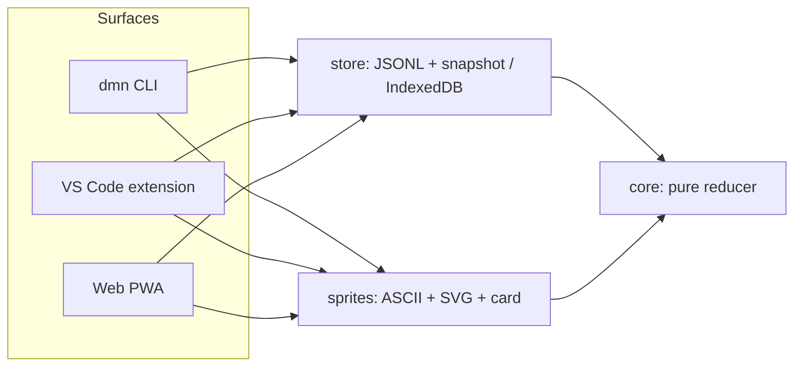
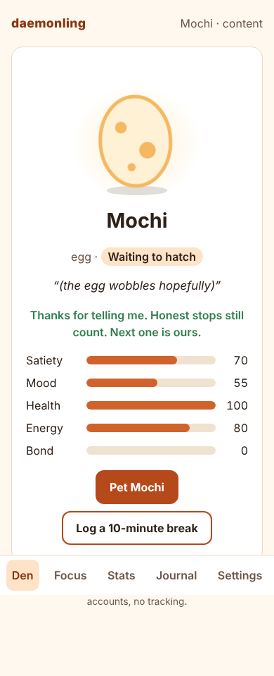
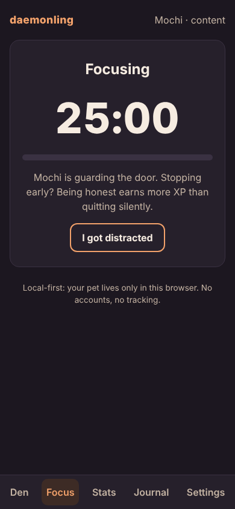
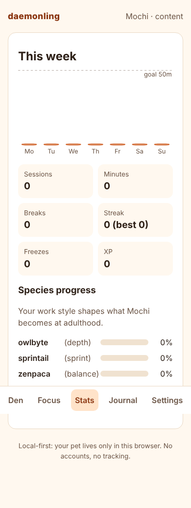

# Case study: Daemonling

_A local-first virtual pet that lives on a developer's focus — engine, CLI, VS Code extension and
web app, built in one sprint._

## Problem

Solo developers work without a manager, standup or team rhythm. Their focus erodes quietly and
overwork goes unnoticed until it becomes burnout. Existing tools either count minutes (timers) or
watch people (trackers); neither makes anyone _care_. Consumer focus pets showed that looking after
a creature motivates people — but developers do not open a phone app mid-flow.

## Role

`[Founder name]` — founder, product designer and engineer. I owned the product definition, game
design, architecture, all code, the original pet art and the documentation.

## Constraints

- **Local-first and private by default:** no accounts, no servers, no telemetry, no network calls.
- **Three runtimes, one brain:** Node CLI, VS Code's CommonJS extension host, and browsers.
- **Deterministic engine:** no clocks or randomness inside the rules; every behaviour testable.
- **Ethical game design:** the pet never dies, recovery is never sold, at most two notifications a
  day.
- **Original art only**, and no use of other virtual-pet trademarks.
- **Speed:** a full MVP plus a founder document pack in a single build sprint.

## Architecture

A pnpm monorepo: `packages/core` (rules), `packages/store` (persistence), `packages/sprites` (art),
and three thin apps. Details in [ARCHITECTURE.md](ARCHITECTURE.md).

## Interesting technical decisions

**Event sourcing.** The pet is `replay(events)`. The log is a human-readable `events.jsonl`; a
snapshot caches the result. This makes the game tunable after launch (change a constant, every pet
recomputes consistently), makes bugs fixable retroactively, and makes future sync a matter of
agreeing on event order rather than merging state.

**A pure engine.** The reducer never reads a clock: time comes from event timestamps, and "random"
message choices come from a hash of the date. That enabled a 60-day simulation of five work-style
personas as an ordinary unit test, asserting that each evolves into its intended species and never
falls below the health floor.

**Time is the hard part.** "Decay only during awake hours, in the user's time zone" had to be exact
for half-hour zones and DST. The first version was correct but slow (`Intl` costs ~80 µs per call);
caching UTC offsets per 15-minute slice and integrating a day at a time made replay about 10× faster.

**Privacy-by-design, checkably.** The VS Code extension reads one boolean — window focus — and the
code that interprets it is a small pure state machine with tests. The privacy promise is a property
of the code, not just a policy page.

**Concurrency without a database.** The CLI and the editor share one log through an exclusive lock
file, single-write appends, and atomic snapshot renames. The reducer ignores a second
`SESSION_COMPLETED`, so two surfaces can both finish a session without double-feeding the pet.

**Performance budget for the shell prompt.** `dmn prompt` had a 50 ms budget. Profiling showed ICU
time zone initialisation (~15 ms) and bundle parsing dominated, so the CLI bundle is code-split and
the prompt reads the cached snapshot without time zone math — about 10 ms over bare Node start-up.

**Accessibility as a test, not a hope.** An axe-core audit of every web screen in both themes found
contrast and landmark issues on the first pass; after fixes it reports zero violations.

## Screenshots

| Den (light)                      | Focus (dark)                        | Stats                                |
| -------------------------------- | ----------------------------------- | ------------------------------------ |
|  |  |  |

`[Add a terminal recording of dmn start and a VS Code status-bar screenshot]`

## Results so far (honest)

- Shipped: engine, CLI, VS Code extension (`.vsix`), offline web app, README card, and a full
  document pack, with CI on every push.
- Quality: 140+ automated tests; engine coverage 100% lines and ~97% branches; zero axe violations.
- Users, retention and revenue: none yet — `[TBD after beta]`.

## What I'd do next

1. Run the private beta and tune constants against real behaviour (tuning plan in
   [GAME_DESIGN.md](GAME_DESIGN.md)).
2. Publish to npm, the VS Code Marketplace and Open VSX.
3. Build opt-in sync on a server-ordered event log, then co-focus dens.
4. Commission an illustrator for new species and cosmetics while keeping the art fully original.
5. Add a terminal recording and real-device testing of the VS Code extension to CI.
