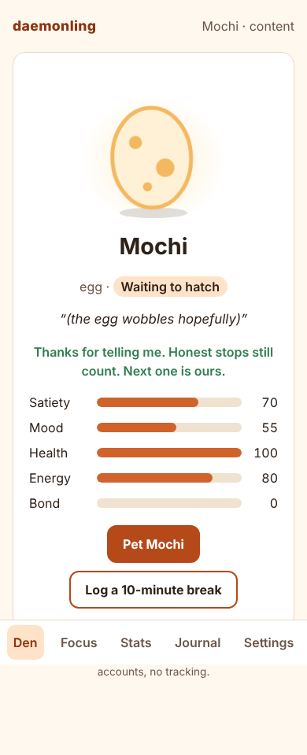
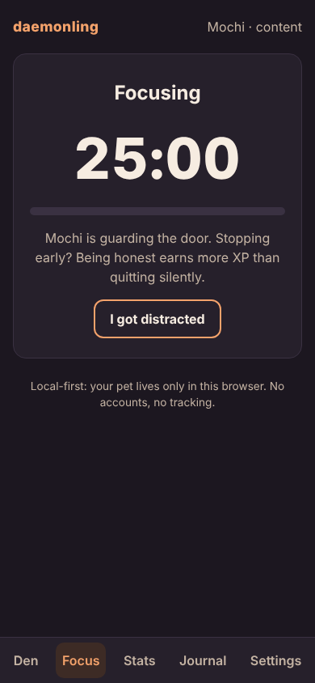
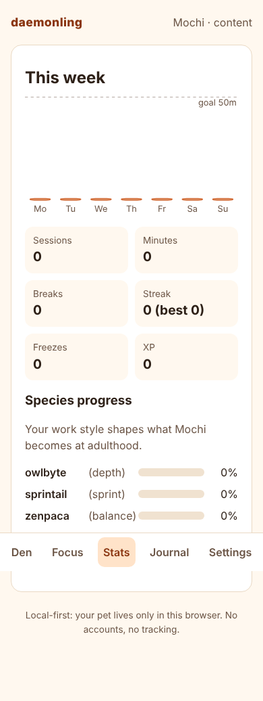

# feat: Daemonling MVP — core engine, CLI, VS Code extension, web home, and founder docs

## Summary

This PR builds the open-core MVP of **Daemonling — a tiny daemon that lives on your focus**: a
virtual pet for solo developers that lives in the terminal, VS Code and the browser. Focus sessions
feed it, streaks teach it tricks, weeks of work evolve it into one of five species, overwork and
late nights tire it, and neglect sends it into a cocoon — it never dies. Everything is local-first:
no accounts, no telemetry, no network calls at runtime.

It also adds the complete founder document pack (user guide, game design, architecture, runbook,
roadmap, product spec, pitch + HTML deck, due diligence, portfolio case study, privacy/security
policies) and the build/decision logs kept milestone by milestone.

## What's included

| Package / app      | What it does                                                                                                                                                                                                                                                                                                                                                                                                                          |
| ------------------ | ------------------------------------------------------------------------------------------------------------------------------------------------------------------------------------------------------------------------------------------------------------------------------------------------------------------------------------------------------------------------------------------------------------------------------------- |
| `packages/core`    | Pure, deterministic, event-sourced simulation: every rule from the spec (decay over awake hours in the user's time zone, sessions, honest vs. silent stops, distraction, breaks, burnout guardian, commits/CI, hunger/health, petting, vacation, conditions, hibernation + wake, streaks + freezes, tricks, stages, evolution), `petSays`, `summarize`, weekly journal, week stats, rubber-duck picker. All constants in `config.ts`. |
| `packages/store`   | Versioned JSONL event log + snapshot in `~/.daemonling` (`DAEMONLING_HOME`), lock file + atomic writes for CLI/VS Code sharing, v1 → v2 example migration, export/import, IndexedDB adapter with the same interface.                                                                                                                                                                                                                  |
| `packages/sprites` | Original art: ASCII frames (6 lines, ≤ 20 columns, 2–4 frames for each of 8 moods, species accents), SVG pet renderer (simple shapes, CSS-variable palette, reduced-motion fallback), README card.                                                                                                                                                                                                                                    |
| `apps/cli` (`dmn`) | `init`, `start` (animated countdown; Ctrl+C asks "Were you distracted?"), `status`, `pet`, `break`, `distracted`, `vacation`, `settings`, `stats [--week]`, `journal`, `duck`, `badge [--from]`, `hook install\|uninstall`, `event commit\|ci-passed`, `prompt`, `export`, `import`. `NO_COLOR`, friendly errors, `--help`. Bundled with esbuild; self-contained npm tarball.                                                         |
| `apps/vscode`      | Status-bar face + condition + session time; quick pick (Start 25/50/90, I got distracted, break, pet, status); privacy-first focus sensing (window focus only) as a pure state machine; ≤ 2 unsolicited notifications/day; "Open Den" webview; settings; `.vsix` built in CI.                                                                                                                                                         |
| `apps/web`         | Offline React + Vite PWA on IndexedDB: Den, Focus, Stats (plain-SVG charts), Journal, Settings (export/import, vacation, theme). Light/dark, mobile-first, keyboard navigable, reduced motion. GitHub Pages workflow.                                                                                                                                                                                                                 |
| CI                 | `.github/workflows/ci.yml`: frozen install, lint, format check, typecheck, tests with coverage gate, build, CLI smoke test, `.vsix` + coverage artifacts. `.github/workflows/pages.yml` for the web app.                                                                                                                                                                                                                              |
| Docs               | README, GUIDE, GAME_DESIGN, ARCHITECTURE, RUNBOOK, ROADMAP, PRODUCT_SPEC, PITCH, `pitch/deck.html`, DUE_DILIGENCE, PORTFOLIO, README-CARD, PRIVACY, SECURITY, CONTRIBUTING, CHANGELOG, DECISIONS (43 entries), BUILD_LOG (one entry + founder's comment per milestone), PROGRESS.                                                                                                                                                     |

## How to try it

```bash
git clone https://github.com/mourya-dasgupta/daemonling && cd daemonling
git checkout feat/daemonling-mvp
corepack enable && pnpm install --frozen-lockfile
pnpm check            # lint + typecheck + test + build
```

CLI:

```bash
ln -s "$PWD/apps/cli/dist/dmn.js" ~/.local/bin/dmn
dmn init --name Pixel
dmn start 25          # Ctrl+C to try the honesty prompt
dmn status
dmn duck
dmn badge --out pet.svg
```

VS Code:

```bash
pnpm --filter daemonling-vscode package
code --install-extension apps/vscode/daemonling-0.1.0.vsix
```

Web:

```bash
pnpm --filter web build && pnpm --filter web preview
```

## Screenshots / ASCII

```
$ dmn status
    *     *     Pixel the sprout (hatchling)
     \   /      thriving
   .-'"""'-.
  (  ^   ^  )   "Best. Owner. Ever. Want to do one more session?"
  (   \_/   )
   '-.___.-'

  Satiety  ██████████ 100
  Mood     █████████░  90
  Health   ██████████ 100
  Energy   ████████░░  83
  Bond     ░░░░░░░░░░   4
```

| README card                      | Species                        |
| -------------------------------- | ------------------------------ |
|  |  |

| Web den (light)                  | Web focus (dark)                    | Web stats                            |
| -------------------------------- | ----------------------------------- | ------------------------------------ |
|  |  |  |

A full CLI smoke-test transcript is in `docs/BUILD_LOG.md` (M7).

## Test & coverage results

- **143 tests in 16 files, all passing** (clean `--frozen-lockfile` run).
- `packages/core`: **100% lines, 97.6% branches, 100% functions** (CI gate ≥ 90%).
- store 99.5% · sprites 99.7% · CLI 90.9% · VS Code 92.1% · web 91–96% (lines). Workspace: 96.2%
  lines, 92.9% branches.
- Highlights: every rule in the spec has a test; "honesty pays" is checked across a grid of moods and
  minutes; a 60-day simulation of five personas (night-owl deep worker → owlbyte, sprinter →
  sprintail, balanced shipper → shipwyrm, zen breaker → zenpaca, midnight coder → nocturne) checks
  evolution and that no pet ever drops below the health floor; CLI integration tests drive
  init → start → status → badge; VS Code activation runs against an in-memory `vscode` stub; web
  tests cover the timer, den mood mapping and a full app flow on `fake-indexeddb`.
- Manual checks: axe-core audit of every web screen in light and dark (0 violations); deck navigation
  and 10-page PDF print in headless Chromium; `dmn prompt` ≈ 10 ms over bare Node start-up.

## Architecture notes

- **Event sourcing:** `state = replay(events)`; the snapshot is a cache. Tuning a constant
  recomputes every pet consistently.
- **Pure engine:** no clock, randomness or I/O in `packages/core`; time comes from event timestamps.
- **Shared local store:** CLI and VS Code append to one JSONL log under a lock file; duplicate
  session completions are no-ops, out-of-order timestamps are clamped.
- **Workspace resolution:** a custom `daemonling-source` export condition lets tests and bundlers use
  TypeScript sources directly; published builds use `dist/`.
- Future sync: server-ordered event log (no CRDTs), opt-in — design only. Details in
  `docs/ARCHITECTURE.md`.

## Privacy

- No accounts, servers, telemetry, analytics or ads; no network calls at runtime (the service worker
  serves only the site's own files).
- Never reads code, file names, window titles or keystrokes. The VS Code extension uses only
  `window.state.focused` during a session (`apps/vscode/src/focus.ts`, tested).
- Data is a readable, exportable, deletable event log. See `PRIVACY.md`.

## Known limitations

- Not yet published to npm, the VS Code Marketplace or Open VSX (steps in `docs/RUNBOOK.md`); install
  from source or the CI `.vsix` artifact.
- The web app keeps its own pet in the browser; move pets with export/import until opt-in sync
  exists.
- The VS Code extension is tested against a stub, not a real VS Code instance; the extension has no
  icon yet.
- `dmn break` logs a break immediately (no break timer). `dmn prompt` shows the cached state without
  applying time since the last event.
- Game balance is untested with real users; two small rules were added to the spec (health regen when
  fed, a small energy cost per focus minute — D-009).
- GitHub Pages deploys only after Pages is enabled in repository settings.
- Founder details, traction and quotes in the pitch documents are placeholders.

## Follow-ups

See [`docs/ROADMAP.md`](ROADMAP.md): private beta with the D7 ≥ 30% gate, npm/Marketplace/Open VSX
publication, the "Scope Creep" ship-day boss fight, opt-in sync, co-focus dens, heirloom eggs, mobile
companion and the team office pet.

## Checklist

- [x] All milestones M0–M7 ticked in `PROGRESS.md`
- [x] `pnpm install --frozen-lockfile && pnpm lint && pnpm typecheck && pnpm test && pnpm build` green
- [x] Core coverage ≥ 90% lines and branches (100% / 97.6%)
- [x] Every rule in the game spec has a test; honesty-pays and 60-day persona simulation pass
- [x] No secrets, telemetry or runtime network calls
- [x] Original art only; no trademarked virtual-pet brand names in names, code, UI or copy (verified by grep)
- [x] Every M6 document exists and matches the code
- [x] BUILD_LOG entry with a founder's comment for every milestone; decisions recorded
- [x] CI green on GitHub
