# README card

Show your daemon on your GitHub profile or project README. The card is a single self-contained SVG
(no external fonts, images or scripts) that shows your pet, its name, species, stage, streak and
condition, and follows the viewer's light or dark theme via `prefers-color-scheme`.



_An example card for a 40-day-old shipwyrm, generated from synthetic events._

## Generate

```bash
dmn badge --out pet.svg
```

`dmn badge` renders your local pet as it is right now. Commit the file and embed it:

```markdown

```

The card is a snapshot: re-run `dmn badge` whenever you want it updated (for example from a
`post-commit` hook or a weekly reminder).

## Embed in your GitHub profile README

1. Create (or open) your profile repository, `github.com/<you>/<you>`.
2. Copy `pet.svg` into it and add `` to its `README.md`.
3. Commit and push.

## Keep it fresh with GitHub Actions

Daemonling never uploads anything on its own. If you want the card regenerated in CI, you choose
what to publish: export your event log, commit it to your profile repository, and let a workflow
render the card from it.

```bash
dmn export --out daemonling-export.json
```

> The export contains only timestamps, minutes, your settings, your pet's name and any optional
> task labels you typed (see [PRIVACY.md](../PRIVACY.md)). Review it before committing it to a
> public repository.

Then add `.github/workflows/daemonling-card.yml` to your profile repository:

```yaml
name: Daemonling card
on:
  push:
    paths: [daemonling-export.json]
  workflow_dispatch:
permissions:
  contents: write
jobs:
  card:
    runs-on: ubuntu-latest
    steps:
      - uses: actions/checkout@v4
      - uses: actions/setup-node@v4
        with:
          node-version: 22
      # Until the CLI is published to npm, build it from source:
      - run: |
          git clone --depth 1 https://github.com/mourya-dasgupta/daemonling /tmp/daemonling
          cd /tmp/daemonling && corepack enable && pnpm install --frozen-lockfile && pnpm build
      - run: node /tmp/daemonling/apps/cli/dist/dmn.js badge --from daemonling-export.json --out pet.svg
      # After the npm release this becomes: npx --yes daemonling badge --from daemonling-export.json --out pet.svg
      - run: |
          git config user.name "daemonling-card"
          git config user.email "daemonling-card@users.noreply.github.com"
          git add pet.svg
          git diff --cached --quiet || git commit -m "chore: update Daemonling card"
          git push
```

`dmn badge --from <file>` renders the pet as of the last event in the export, so the card does not
"decay" just because CI ran later.

## Customising

The pet inside the card uses CSS custom properties (`--dl-body`, `--dl-accent`, `--dl-glow`,
`--dl-ink`, `--dl-cheek`). The colours for each species are defined once in
`packages/sprites/src/svg.ts` (`PALETTES`).
