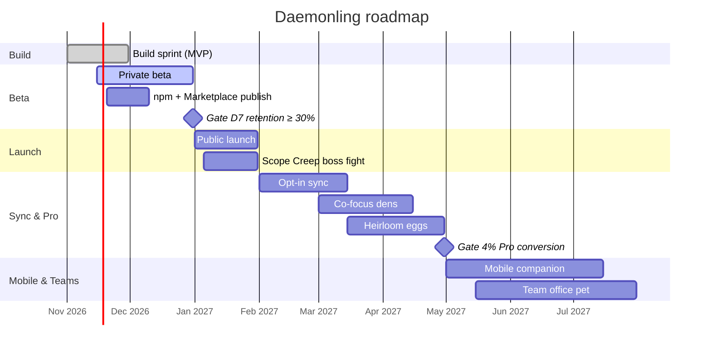

# Roadmap

Dates are targets, not promises. Each phase has a gate that must be met before moving on.

## Phases

| Phase              | When         | Goal                                                                                            | Gate to move on                                            |
| ------------------ | ------------ | ----------------------------------------------------------------------------------------------- | ---------------------------------------------------------- |
| **Build sprint**   | Nov 2026     | Open-core MVP: engine, CLI, VS Code extension, web home, docs (this PR)                         | CI green, core coverage ≥ 90%, docs match the code         |
| **Private beta**   | Nov–Dec 2026 | 50–200 solo developers; tune the game; publish CLI to npm and extension to Marketplace/Open VSX | **D7 retention ≥ 30%** (opt-in survey + voluntary exports) |
| **Public launch**  | Jan 2027     | Launch posts, README card virality, Pages-hosted web home                                       | Weekly Fed Pets growing week over week `[TBD after beta]`  |
| **Sync & Pro**     | Feb–Apr 2027 | Opt-in sync (server-ordered event log), Pro cosmetics and species, co-focus dens, insights      | **4% conversion of weekly users** to Pro                   |
| **Mobile & Teams** | May–Jul 2027 | Native mobile companion; team office pet                                                        | Teams pilots with retained weekly usage `[TBD]`            |

## Backlog (12 features)

| #   | Feature             | Description                                                                                  | Status                                 |
| --- | ------------------- | -------------------------------------------------------------------------------------------- | -------------------------------------- |
| 1   | Terminal daemon     | `dmn`: sessions, live countdown, status, stats, export/import, prompt line                   | **Shipped in this PR**                 |
| 2   | Editor companion    | VS Code status-bar pet, quick actions, privacy-first focus sensing, den webview              | **Shipped in this PR**                 |
| 3   | Commit treats       | Post-commit hook; commits during sessions feed the pet; CI passes celebrate                  | **Shipped in this PR**                 |
| 4   | Rubber duck         | `dmn duck` keyword-driven debugging questions (offline). BYO-LLM mode later                  | **Shipped (offline)**; BYO-LLM planned |
| 5   | README card         | Self-contained SVG card, local or from an export in CI                                       | **Shipped in this PR**                 |
| 6   | Weekly journal      | Warm weekly letter in the pet's voice (CLI + web)                                            | **Shipped in this PR**                 |
| 7   | Burnout guardian    | Overwork yawn, late-night energy cost, breaks rewarded                                       | **Shipped in this PR**                 |
| 8   | Vacation mode       | Pause decay, streak and hibernation                                                          | **Shipped in this PR**                 |
| 9   | Ship-day boss fight | "Scope Creep": on a declared ship day, sessions and commits chip away at a boss; ship to win | Planned (Public launch)                |
| 10  | Co-focus dens       | Body doubling: focus alongside friends' daemons in a shared den; community "focus raids"     | Planned (Sync & Pro)                   |
| 11  | Heirloom eggs       | An Elder mentors a new egg and passes on one trait                                           | Planned (Sync & Pro)                   |
| 12  | Team office pet     | A shared pet fed by a small team's balanced work (never individual surveillance)             | Planned (Mobile & Teams)               |

Also planned for the beta: npm and Marketplace publication, a JetBrains plugin spike, localisation
of the pet's voice, PNG extension icon, and shell prompt snippets for fish and PowerShell.

## Timeline

